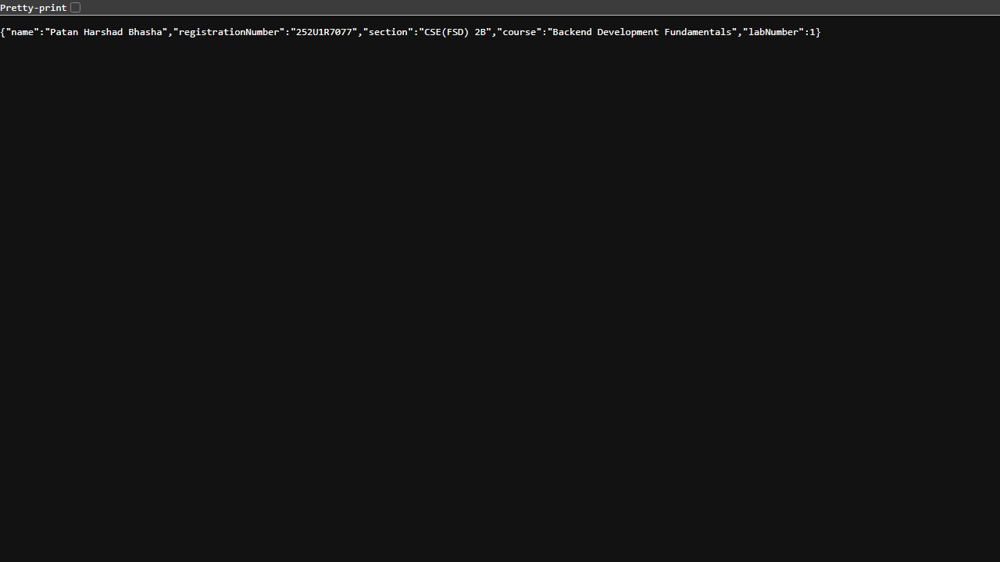

# Lab 1: Node.js and Express Server

## Student Details

| Field | Value |
|---|---|
| **Name** | Patan Harshad Bhasha |
| **Registration Number** | 252U1R7077 |
| **Section** | CSE(FSD) 2B |
| **Course** | Backend Development Fundamentals |
| **Lab Number** | Lab 1 |

## Live Link

Deployment is not done yet, so there is no live URL. The application runs locally on port `3000` (see *Steps to Run* below). The code was written so it can also use a platform-provided port (`process.env.PORT || 3000`), which is the requirement of most Node.js hosting platforms. See *Git and Repository Notes* for the remaining deployment steps.

## Objective

1. Initialize a Node.js project using `npm init -y`.
2. Install Express using `npm install express`.
3. Create a basic HTTP server using Node.js's built-in `http` module.
4. Create an Express server using `const app = express()`.
5. Run the server on port `3000` by default.
6. Implement the required endpoints (`/`, `/about`, `/time`) and a `404` response for unknown routes.
7. Return the correct HTTP status codes (`200 OK` for the defined routes, `404 Not Found` for undefined routes).
8. Test the routes and document the results.

## Technologies Used

* **Node.js** v20 (JavaScript runtime)
* **Express.js** v5 (`npm install express`)
* **npm** (package manager)
* No database, frontend framework, or authentication — a simple, beginner-friendly backend lab.

## Project Structure

```
lab-01/
├── server-http.js        # Basic HTTP server using Node's built-in "http" module (no Express)
├── server.js             # Express server with all routes and status codes
├── package.json          # Project metadata, scripts and the Express dependency
├── package-lock.json     # Auto-generated by npm, locks exact dependency versions
├── .gitignore            # Excludes node_modules/ and .env from Git
├── screenshots/
│   ├── home.png          # GET /  -> welcome message (200 OK)
│   ├── about.png         # GET /about -> student details JSON (200 OK)
│   ├── time.png          # GET /time -> current date and time (200 OK)
│   └── not-found.png     # GET /anything -> 404 Not Found
└── node_modules/         # Installed dependencies (NOT committed to Git)
```

## Installation and Setup

Prerequisites: Node.js (v18 or later) and npm.

```bash
# 1. Open a terminal inside the lab-01 folder

# 2. Initialize the Node.js project
npm init -y

# 3. Install Express
npm install express
```

`npm init -y` generates `package.json` with default values, and `npm install express` downloads Express into `node_modules/` and records it in `package.json` and `package-lock.json`.

## Steps to Run

```bash
# Start the Express server (port 3000 by default)
node server.js

# Or, using the npm script:
npm start
```

Expected output:

```
Express server running at http://localhost:3000
```

Then test the routes in a browser:

| Route | Open In Browser | Expected Result |
|---|---|---|
| `GET /` | `http://localhost:3000/` | `Welcome to Lab 1: Node.js and Express Server` with status **200 OK** |
| `GET /about` | `http://localhost:3000/about` | JSON with the student's name, registration number and section, status **200 OK** |
| `GET /time` | `http://localhost:3000/time` | `Current date and time: ...` with the live date/time, status **200 OK** |
| `GET /anything` | `http://localhost:3000/anything` | `404 - Page Not Found` with status **404 Not Found** |

> `/anything` is just an example path. **All** undefined routes (e.g. `/abc`, `/xyz`) return the same `404 - Page Not Found` response with HTTP status `404`.

## How to Run the Basic HTTP Server

```bash
# Start the plain Node.js server (no Express)
node server-http.js
```

Expected output:

```
Basic HTTP server (http module) running at http://localhost:3000
```

* Open `http://localhost:3000/` → responds with plain text `Hello` (**200 OK**).
* Any other path (e.g. `http://localhost:3000/xyz`) → `404 - Page Not Found` (**404 Not Found**).

> Stop the Express server first (Ctrl + C) before starting this server, because both use port `3000`.

## Endpoints

| Method | Endpoint | Description | Expected Status |
|---|---|---|---|
| GET | `/` | Welcome message | 200 OK |
| GET | `/about` | Student name and section in JSON | 200 OK |
| GET | `/time` | Current date and time | 200 OK |
| GET | `/anything` | Unknown route demonstration | 404 Not Found |

`/anything` is an example of an undefined path — every other undefined route also returns `404 Not Found` because of the catch-all handler at the end of `server.js`.

Both servers were created with `http.createServer()` / `app.listen()` on port 3000, and tested with `curl` and a browser. Actual response status codes are listed in *Test Results* below.

## Screenshots

Basic HTTP server (http module):


Express server routes:





## Test Results

All commands below were actually run against the running servers, and the status codes shown are the real HTTP responses.

Basic HTTP server (`node server-http.js`):

| Request | Actual Status | Actual Body |
|---|---|---|
| `GET /` | `200 OK` | `Hello` |
| `GET /anything` | `404 Not Found` | `404 - Page Not Found` |

Express server (`node server.js`):

| Request | Actual Status | Actual Body |
|---|---|---|
| `GET /` | `200 OK` | `Welcome to Lab 1: Node.js and Express Server` |
| `GET /about` | `200 OK` | `{"name":"Patan Harshad Bhasha","registrationNumber":"252U1R7077","section":"CSE(FSD) 2B","course":"Backend Development Fundamentals","labNumber":1}` (valid JSON, `Content-Type: application/json`) |
| `GET /time` | `200 OK` | `Current date and time: Sun Nov 01 2026 22:57:22 GMT+0530 (India Standard Time)` |
| `GET /anything` | `404 Not Found` | `404 - Page Not Found` |

The JSON from `/about` was verified to be valid JSON, and both servers start without runtime errors.

## HTTP Status Codes

* **200 OK** — The request succeeded. The server returns the requested content (welcome text, JSON data, or the current date/time) with a `200` status for `/`, `/about`, and `/time`.
* **404 Not Found** — The server could not find the requested resource. Every undefined route gets a `404` status (not just a message containing "404"), set explicitly with `res.writeHead(404, ...)` in the http server and `res.status(404)` in Express.

## About package.json

The following are the important fields in `package.json` of this project:

* **`name`** — The project name (`lab-01`). It must be lowercase and URL-safe.
* **`version`** — The project version (`1.0.0`), following semantic versioning.
* **`description`** — A short summary of what the project does.
* **`main`** — The entry point of the application (`server.js`); the first file Node runs when the package is required.
* **`scripts`** — Shortcut commands: `npm start` runs `node server.js` and `npm run start:http` runs `node server-http.js`.
* **`dependencies`** — Packages the project needs to run, here `express ^5.3.0` (installed with `npm install express`).
* **`license`** — The license of the project (`ISC` by default from `npm init -y`).

Also generated by npm: **`package-lock.json`** records the exact versions of every installed package (including Express's own dependencies), so `npm install` reproduces the same setup on any machine.

The differences between `package.json` and `node_modules/` are explained in the viva answers below.

## Viva Questions and Answers

**1. What is the difference between `package.json` and `node_modules`?**

`package.json` is a small text file listing the project's metadata and the packages (dependencies) it needs — it is committed to Git. `node_modules` is the large folder where npm actually downloads the installed package code, including every sub-dependency — it is NOT committed to Git. Anyone can recreate `node_modules` from `package.json` (and `package-lock.json`) by running `npm install`.

**2. What does `app.listen()` do?**

`app.listen(PORT)` starts the Express server and makes it begin accepting HTTP connections on the given port. The callback function we pass runs once the server is ready, and we use it to print `Express server running at http://localhost:3000`. It returns an HTTP server object (the same kind the `http` module creates) that keeps running until the program is stopped.

**3. What do request and response represent?**

The `request` (`req`) object represents what the client sent — the URL path (`req.url`), HTTP method, headers and any body. The `response` (`res`) object is how the server replies — its status code (`res.status(200)`), headers (`Content-Type`) and body (`res.send()`, `res.json()`,`res.end()`). Each browser request creates one request/response pair handed to our handler.

## Problems Faced and Solutions

* **Port already in use:** When starting the Express server while the previous server was still running on port `3000`, the port is occupied. Solution: stop the previous server with `Ctrl + C` before starting the other one.
* **Node.js not being pre-installed on this machine:** Node had to be installed before `npm init -y` could be run. Solution: install Node.js (v20) first and verify with `node --version`.
* **Checking status codes:** Plain browser views only show the rendered page body, not the status code. Solution: also test with `curl -i http://localhost:3000/about` to confirm real status codes (`200`, `404`) directly from the server.

## Git and Repository Notes

* `.gitignore` excludes `node_modules/`, `.env` and npm logs, so dependencies and secrets are never committed.
* To publish this lab on GitHub:
  ```bash
  cd lab-01
  git init
  git add .
  git commit -m "Lab 1: Node.js and Express server"
  git branch -M main
  git remote add origin <your-repo-url>
  git push -u origin main
  ```
* Live deployment is not completed yet. A free Node.js hosting platform (e.g. Render or Railway) can run `node server.js` automatically — they provide their own port, which the code already supports via `process.env.PORT || 3000`. Steps: push the repo to GitHub → create a "Web Service" on the platform pointing to the repo → set the build/start commands (`npm install`, `node server.js`) → the platform will show a public live URL.
* No live URL is claimed anywhere in this README because no deployment has been performed yet.
